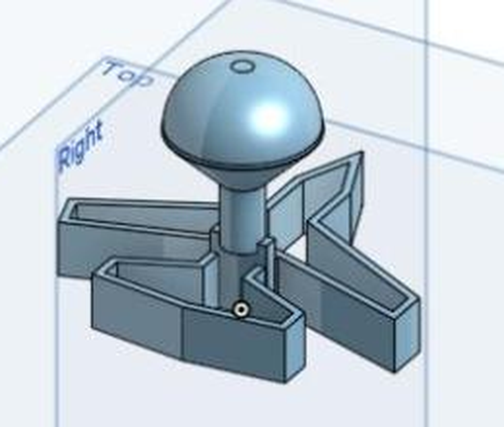

# Airplane Cookie Cutter

An airplane-shaped cookie cutter for the Hack Club BakeBuild mission, designed in Onshape.

- Stick handle with a dome on top, easy to hold
- Built-in print supports (45° cone under the dome and a support web under the bar) so the handle doesn't break
- Wall 2 mm, cutting depth 12.7 mm

Model: `airplane-cookie-cutter.step`

Onshape design (view only): https://cad.onshape.com/documents/ee4edb7de2dad750b51dade6/w/218288b3c0dc4d85b227c531/e/4e51bad17b0f927fdbd58d1d
